<div align="center">

  <!-- HERO SVG BANNER -->
  <a href="https://pouriyaparniyan.ir">
    
  </a>

  <br/>

  <!-- DYNAMIC TYPING SVG -->
  <a href="https://pouriyaparniyan.ir">
    
  </a>

  <br/>

  <!-- QUICK ACTION BADGES -->
  <p align="center">
    <a href="https://pouriyaparniyan.ir">
      
    </a>
    <a href="https://discord.gg/BgFABrF6km">
      
    </a>
    <a href="https://youtube.com/@wild-life-studio">
      
    </a>
    <a href="https://instagram.com/wl_pooriya">
      
    </a>
    <a href="https://pouriyaparniyan.ir/donate">
      
    </a>
  </p>

  <!-- PROFILE VISITOR BADGE -->
  <p align="center">
    
  </p>

</div>


## ⚡ About Me

```yaml
identity:
  name: Pouriya Parniyan
  role: Full-Stack Developer & Desktop Application Architect
  organization: Founder @ Wild Life Studio (wl-std)
  personality: ENTJ-A (The Commander) — High standards, strategic execution & clean architecture
  location: Iran 📍
  passions: System utilities, high-concurrency bot infrastructure, responsive UI & developer tools
  fuel: Lo-Fi beats, underground rap, and midnight code commits 🎧☕
  current_mission: Engineering sleek Windows telemetry apps & robust monitoring platforms
```

<br/>

<table>
  <tr>
    <td width="55%" valign="top">
      <h3>🚀 What I Do</h3>
      <ul>
        <li>🖥️ <b>Desktop Architecture:</b> Crafting modern, fluent Windows 11 apps like <a href="https://github.com/pooriyayt/pulse-system-monitor"><b>Pulse System Monitor</b></a> with C# & .NET.</li>
        <li>🌐 <b>Full-Stack Web:</b> Building resilient web services, uptime monitors (<a href="https://github.com/pooriyayt/uptimeplus.ir"><b>UptimePlus.ir</b></a>), and real-time dashboards.</li>
        <li>🤖 <b>Bot Ecosystems:</b> Developing multi-purpose Discord bots (Music, Radio, Moderation, Tickets) handling complex user interactions.</li>
        <li>🎨 <b>UI/UX & Visuals:</b> Translating complex workflows into intuitive, aesthetic interfaces using Figma & modern CSS frameworks.</li>
        <li>⚡ <b>Open Source:</b> Contributing and shipping tools that make developers' lives easier.</li>
      </ul>
    </td>
    <td width="45%" align="center" valign="middle">
      <h3>🎮 Live Discord Status</h3>
      <a href="https://discord.com/users/375620573541302272">
        
      </a>
    </td>
  </tr>
</table>


## 🛠️ Tech Stack & Arsenal

<div align="center">

### 💻 Core Languages
<p>
  
  
  
  
  
  
  
  
</p>

### ⚙️ Frameworks, Environments & Desktop
<p>
  
  
  
  
  
  
</p>

### 🗄️ Databases & Storage
<p>
  
  
  
  
</p>

### 🚀 DevOps, Infrastructure & Servers
<p>
  
  
  
  
  
  
</p>

### 🎨 Creative & UI/UX Suite
<p>
  
  
  
</p>

</div>


## 🌟 Featured Projects

<table>
  <tr>
    <td width="50%" valign="top">
      <h3 align="left">
        <a href="https://github.com/pooriyayt/pulse-system-monitor">📊 Pulse System Monitor</a>
      </h3>
      <p>A beautiful, modern Windows 11 task manager & system telemetry monitor. Featuring live CPU/GPU/RAM graphs, per-process analytics, and a fluent UI.</p>
      <p>
        
        
      </p>
    </td>
    <td width="50%" valign="top">
      <h3 align="left">
        <a href="https://github.com/pooriyayt/uptimeplus.ir">🌐 UptimePlus.ir</a>
      </h3>
      <p>Professional uptime & service monitoring system for websites and APIs. Offers real-time alerts, SLA reporting, and custom branded status pages.</p>
      <p>
        
        
        
      </p>
    </td>
  </tr>
  <tr>
    <td width="50%" valign="top">
      <h3 align="left">
        <a href="https://github.com/pooriyayt/codepulse">⚡ CodePulse</a>
      </h3>
      <p>A static code health dashboard for any codebase. Upload code or point to a repository to get instant analysis, structure diagrams, and quality insights.</p>
      <p>
        
        
      </p>
    </td>
    <td width="50%" valign="top">
      <h3 align="left">
        <a href="https://github.com/pooriyayt/WL-Downloader">📥 WL-Downloader & Pro-Downloader</a>
      </h3>
      <p>Intelligent multi-threaded file downloader with smart categorization, queue management, and automated GitHub Actions workflows.</p>
      <p>
        
        
      </p>
    </td>
  </tr>
  <tr>
    <td width="50%" valign="top">
      <h3 align="left">
        <a href="https://github.com/pooriyayt/discord-radio-bot">📻 Discord Radio & Music Bots</a>
      </h3>
      <p>High-performance Discord music and radio bots supporting YouTube, Spotify, SoundCloud, and 24/7 web radio playback with low latency.</p>
      <p>
        
        
      </p>
    </td>
    <td width="50%" valign="top">
      <h3 align="left">
        <a href="https://github.com/pooriyayt/StudyMasterPro">📚 StudyMaster Pro</a>
      </h3>
      <p>Powerful desktop workflow and study management application built with PyQt5. Includes Pomodoro timers, habit trackers, and task analytics.</p>
      <p>
        
        
      </p>
    </td>
  </tr>
</table>


## 📈 GitHub Analytics & Activity

<div align="center">
  <table border="0">
    <tr>
      <td align="center" valign="middle">
        <a href="https://github.com/pooriyayt">
          
        </a>
      </td>
      <td align="center" valign="middle">
        <a href="https://github.com/pooriyayt">
          
        </a>
      </td>
    </tr>
    <tr>
      <td colspan="2" align="center" valign="middle">
        <a href="https://github.com/pooriyayt">
          
        </a>
      </td>
    </tr>
  </table>
</div>

<br/>

<div align="center">
  <h3>✍️ Dev Philosophy</h3>
  <a href="https://quotes-github-readme.vercel.app/api?type=horizontal&theme=tokyonight">
    
  </a>
</div>


## 🤝 Let's Connect & Collaborate

<div align="center">

  <p>Whether you want to discuss a project, need a custom Discord bot, want to collaborate on open-source software, or just chat about code & beats:</p>

  <p>
    <a href="https://pouriyaparniyan.ir">
      
    </a>
    <a href="https://discord.gg/BgFABrF6km">
      
    </a>
    <a href="https://discord.com/users/375620573541302272">
      
    </a>
    <a href="https://youtube.com/@wild-life-studio">
      
    </a>
    <a href="https://instagram.com/wl_pooriya">
      
    </a>
  </p>

  <br/>

  <a href="https://pouriyaparniyan.ir/donate">
    
  </a>

  <br/><br/>

  <p align="center">
    <i>Crafted with 💙 by <b>Pouriya Parniyan</b> • Powered by Open Source</i>
  </p>

</div>
